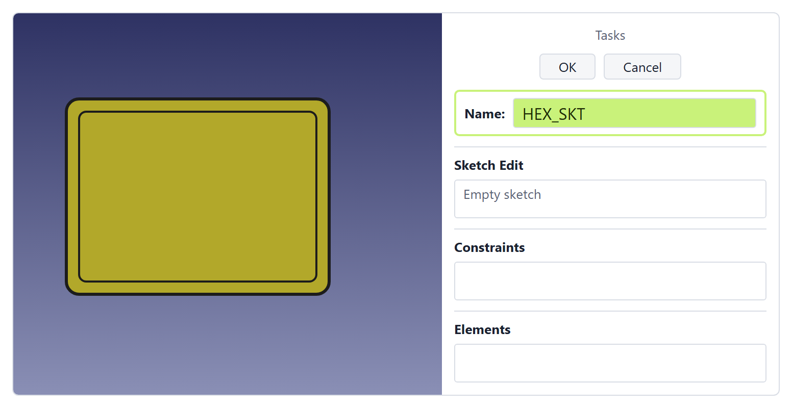
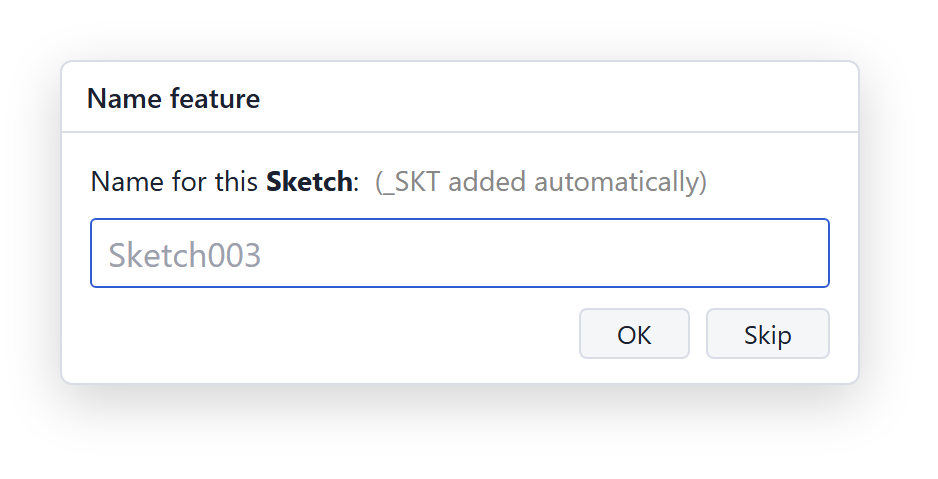
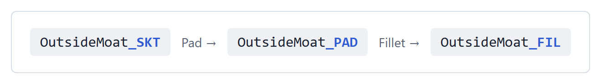
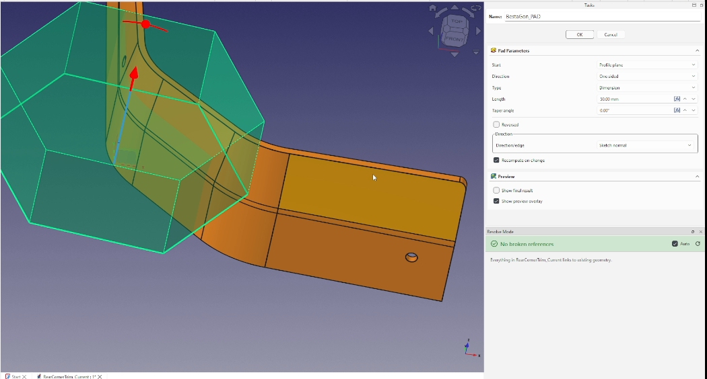
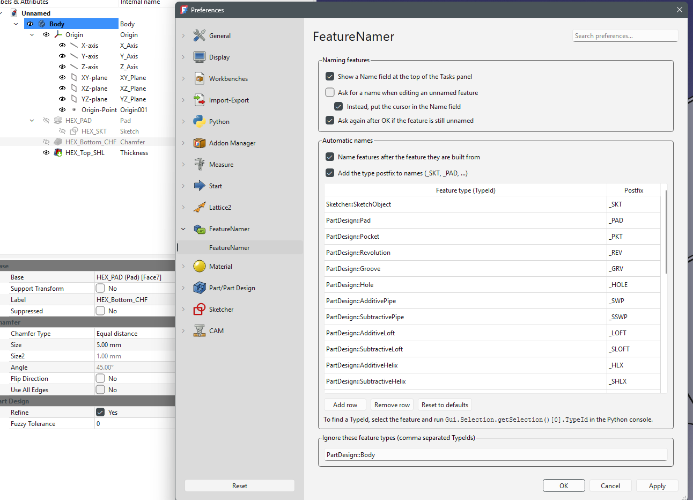

<p align="center">
  
</p>

<h1 align="center">FeatureNamer</h1>

<p align="center">
  <b>Name Sketcher and PartDesign features where you make them.</b><br>
  No more <code>Sketch007</code>, <code>Pad004</code>, <code>Pocket012</code>.
</p>

<p align="center">
  <a href="https://avongil.github.io/FreeCAD-FeatureNamer/"><b>Manual</b></a> ·
  <a href="https://avongil.github.io/FreeCAD-FeatureNamer/how-it-works.html"><b>How it works</b></a> ·
  <a href="https://avongil.github.io/FreeCAD-FeatureNamer/#demo"><b>Demo video</b></a> ·
  <a href="#install">Install</a> ·
  <a href="#settings">Settings</a> ·
  <a href="CHANGELOG.md">Changelog</a>
  <br><br>
  
  
  
</p>

---

A feature is easiest to name right after you create it, while you still know what it's for. FreeCAD's task dialogs have nowhere to type a name, so you have to go back to the tree, find the item, rename it, and return to your work. Most of the time, nobody bothers. FeatureNamer adds the name field that tools like SolidWorks and Alibre have, and names most features for you.

## What it does

### A Name field in every task dialog

While a Sketch or PartDesign feature is being edited, a **Name** field sits at the top of the Tasks panel. The tree updates as you type. **Enter** confirms and gives focus back to the 3D view, and **Cancel** or **Ctrl+Z** undo the rename together with the feature.

<p align="center"></p>

### Asks when a feature is unnamed

If a feature still has its default name, a small dialog asks for one. Type the name and press Enter, or click **Skip**. If you'd rather not be interrupted, it can put the cursor in the Name field instead. It can also ask once more after **OK**.

<p align="center"></p>

### Names features for you

Most features are built from another feature. When that one already has a name, the new feature is named automatically and nothing pops up. The base name carries forward, and only the type postfix changes.

<p align="center"></p>

In a real model: the sketch was named `BestaGon` in the popup (`_SKT` added), so the Pad opens already named `BestaGon_PAD`.

<p align="center"></p>

- **Postfixes:** type `OutsideMoat` for a sketch and you get `OutsideMoat_SKT`. If you type the postfix yourself, it isn't added twice.
- **Where the name comes from:** `Profile` (Pad, Pocket, Revolution, Groove, Hole, Sweep, Loft, Helix), `Base` (Fillet, Chamfer, Draft, Thickness) or `Originals` (patterns and Mirrored).
- **When it still asks:** new sketches always ask, and so does a feature whose source still has a default name.

| Feature | Postfix | Feature | Postfix |
|---|---|---|---|
| Sketch | `_SKT` | Fillet | `_FIL` |
| Pad | `_PAD` | Chamfer | `_CHF` |
| Pocket | `_PKT` | Draft | `_DFT` |
| Revolution | `_REV` | Thickness | `_SHL` |
| Groove | `_GRV` | Mirrored | `_MIR` |
| Hole | `_HOLE` | Linear / polar pattern | `_LPAT` / `_PPAT` |
| Sweep (additive / subtractive pipe) | `_SWP` / `_SSWP` | MultiTransform | `_MTR` |
| Loft (additive / subtractive) | `_LOFT` / `_SLOFT` | Boolean | `_BOOL` |
| Helix (additive / subtractive) | `_HLX` / `_SHLX` | Datum plane / line / point | `_PLN` / `_AXS` / `_PNT` |

## Settings

Everything is on one page: **Edit > Preferences > FeatureNamer**. You can also open it from **Tools > FeatureNamer settings...**, the entry with the green tag icon below *Edit Parameters*. That entry works even while you're sketching.

<p align="center"></p>
<p align="center"><sub>On the left is the tree it produces. The Pad built from <code>HEX_SKT</code> was named <code>HEX_PAD</code> automatically.</sub></p>

<details>
<summary>All parameters (stored in <code>BaseApp/Preferences/Mod/FeatureNamer</code>)</summary>

| Parameter | Default | Effect |
|---|---|---|
| `ShowNameField` | on | Name field at the top of the Tasks panel |
| `PromptIfUnnamed` | on | Popup when editing starts on a default-named feature |
| `FocusNameField` | off | Put the cursor in the Name field instead of a popup |
| `AskOnClose` | off | Ask again after OK if the name is still the default, even if you skipped the first popup |
| `NameFromBase` | on | Name a feature after the feature it is built from, without asking |
| `AutoPostfix` | on | Add the type postfix to names |
| `Postfixes` | see table above | One `TypeId=postfix` per line |
| `ExcludeTypes` | `PartDesign::Body` | Comma-separated TypeIds to ignore |

</details>

## Install

Requires FreeCAD 1.1 or newer. Developed on FreeCAD 27.1.0dev (weekly 2026.11.04).

### With the Addon Manager (recommended)

FeatureNamer isn't in the official addon list yet, so add it once as a custom repository:

1. **Edit > Preferences > Addon Manager > Custom repositories**: add
   `https://github.com/avongil/FreeCAD-FeatureNamer` with branch `main`.
2. Open **Tools > Addon Manager**, find **FeatureNamer**, and click **Install**.
3. Restart FreeCAD.

The Addon Manager also tells you when there's an update.

### By hand

1. Click **Code > Download ZIP** on this page and unzip it.
2. Rename the unzipped folder from `FreeCAD-FeatureNamer-main` to **`FeatureNamer`**.
3. Move it into the `Mod` folder of your FreeCAD user folder:

   ```
   <your FreeCAD user folder>/
   └── Mod/
       └── FeatureNamer/            <- the unzipped folder, renamed
           ├── package.xml
           └── freecad/
               └── FeatureNamer/
                   ├── init_gui.py
                   └── ...
   ```

4. Restart FreeCAD.

<details>
<summary>Where is my FreeCAD user folder?</summary>

In FreeCAD, open *View > Panels > Python console* and type `App.getUserAppDataDir()`. It prints the path. Usually it is:

- Windows: `%APPDATA%\FreeCAD\vXX-Y` (for example `C:\Users\<you>\AppData\Roaming\FreeCAD\v1-1`)
- Linux: `~/.local/share/FreeCAD/vXX-Y`
- macOS: `~/Library/Application Support/FreeCAD/vXX-Y`

`vXX-Y` is your FreeCAD version. If there's no `Mod` folder yet, create it.

</details>

## How it works

FeatureNamer is pure Python and doesn't change any FreeCAD code. A Gui document observer notices when a Sketch or PartDesign feature enters edit mode, adds the Name field to the Tasks panel, and reads the feature's `Profile`, `Base` or `Originals` to work out its name. The [manual](https://avongil.github.io/FreeCAD-FeatureNamer/#how) has the details, the known limits, and a short proposal for adding this to FreeCAD itself. Developers: [how it works](https://avongil.github.io/FreeCAD-FeatureNamer/how-it-works.html) walks through the edit lifecycle, naming rules and transactions.

## Development

Modern FreeCAD addon layout: code in `freecad/FeatureNamer/`, metadata in `package.xml`. The naming rules live in `core/naming.py` with no FreeCAD imports, and are tested with:

```
python -m unittest tests/test_naming.py
```

## Status and license

Working prototype, offered as a proposal for a feature-name field in FreeCAD's task dialogs. Feedback and issues are welcome.

LGPL-2.1-or-later, the same license as FreeCAD.
